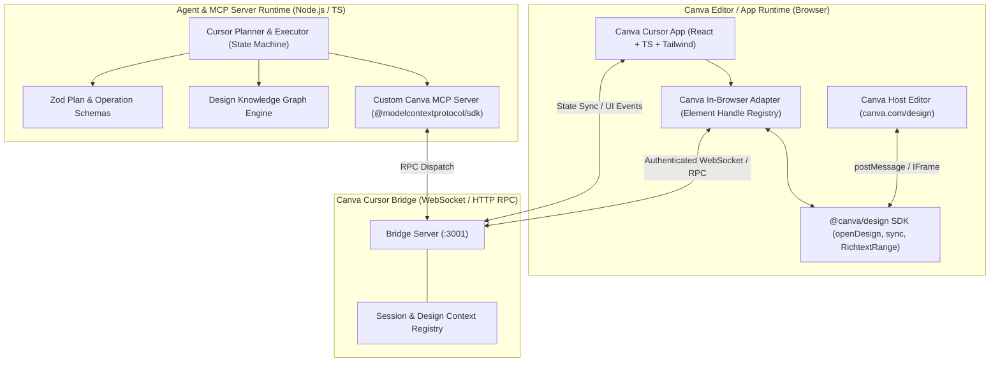

# Canva Cursor — System Architecture Proposal

## 1. Executive Overview

**Canva Cursor** brings Cursor's intelligent, codebase-level editing paradigm to visual design in Canva. Rather than treating design editing as blind conversational chat, Canva Cursor treats a design document as a structured, relational artifact:
1. **Understands** the design via a **Design Knowledge Graph** capturing geometry, hierarchy, styles, and spatial/semantic relationships.
2. **Plans** deterministic, constraint-validated edits using structured LLM tool orchestration with Zod validation.
3. **Executes** atomic mutations through a typed **Model Context Protocol (MCP)** tool layer.
4. **Bridges** server-side AI execution to the browser-based Canva session via an authenticated, real-time bidirectional **Canva Bridge Protocol**.
5. **Verifies** post-mutation state against live Canva attributes, reconciling the knowledge graph and reporting exact diffs to the user.

---

## 2. High-Level System Architecture

---

## 3. Component Deep Dive

### A. Canva Integration Layer & In-Browser Adapter
* **Runtime Reality**: Canva Apps SDK (`@canva/design` v2.13.1) executes inside a sandboxed browser iframe. It communicates with Canva's canvas renderer via internal `postMessage` channels. A standalone Node process cannot natively load browser SDK globals.
* **The Bridge Pattern**:
  - The Canva App registers with the local Bridge Server upon loading, advertising the active `designId` and `pageId`.
  - The Bridge issues commands (`SNAPSHOT_REQUEST`, `MUTATION_REQUEST`, `VERIFY_REQUEST`) to the browser session.
  - The In-Browser Adapter executes inside `openDesign({ type: 'current_page' }, async (session) => { ... })`, performs mutations, calls `await session.sync()`, re-reads the element properties to verify, and returns the result to the bridge.
* **Element Identification Strategy**:
  - Official Canva `Element` objects in `@canva/design` have no public native `id` field.
  - The In-Browser Adapter assigns deterministic, stable Element Handles: `elem_<type>_<index>_<contentHash>` and maintains a per-session reference map pointing to the live `AbsoluteElement` instances within the active `openDesign` session.

### B. Design Knowledge Graph (`@canva-cursor/knowledge-graph`)
* **Pure TypeScript in-memory relational graph**: Decoupled from the Canva SDK, fully serializable, and easily testable.
* **Nodes**:
  - `PageNode`: ID, dimensions (width, height), background fill, locked state.
  - `ElementNode`: Handle ID, element type (`text`, `shape`, `rect`, `group`, `embed`), geometry (`top`, `left`, `width`, `height`, `rotation`, `transparency`), styling (color, fontSize, fontWeight, fontStyle, textAlign), content, locked state, z-index, semantic role.
* **Inferred Semantic Roles**: `heading_main`, `heading_sub`, `body`, `caption`, `logo`, `cta`, `card`, `background`, `image`.
* **Spatial & Relational Edges**:
  - `CONTAINS` (Page -> Element, Group -> Element)
  - `ALIGNED_WITH` (left, right, center_x, center_y, top, bottom within tolerance $\epsilon \le 4\text{px}$)
  - `NEAR` (Euclidean distance between bounding boxes $\le 60\text{px}$)
  - `OVERLAPS` (AABB bounding box intersection)
  - `ABOVE` / `BELOW` (vertical dominance with horizontal alignment)
  - `SAME_STYLE_AS` (shared typography / color palettes)
  - `SEMANTICALLY_RELATED_TO` (e.g. title paired with subtitle)
* **Reconciliation & Staleness Detection**:
  - Calculates graph state hash.
  - Detects out-of-band canvas mutations before applying planned operations.

### C. Custom MCP Server (`@canva-cursor/mcp-server`)
* Built with official `@modelcontextprotocol/sdk`.
* Exposes typed tools across 4 categories:
  1. **Inspection**: `get_design_snapshot`, `get_node_details`, `find_main_headings`, `find_elements_by_text`, `query_design_graph`.
  2. **Styling**: `update_text_style`, `update_fill_color`, `update_font_size`, `update_text_content`.
  3. **Layout**: `move_element`, `resize_element`, `align_elements`, `distribute_elements`.
  4. **Structure & Verification**: `delete_element`, `verify_element_properties`, `refresh_design_state`.

### D. AI Agent Planner & Deterministic State Machine
* **Deterministic Execution Lifecycle**:
  `IDLE` $\rightarrow$ `INSPECTING_DESIGN` $\rightarrow$ `BUILDING_GRAPH` $\rightarrow$ `RESOLVING_TARGETS` $\rightarrow$ `GENERATING_PLAN` $\rightarrow$ `VALIDATING_CONSTRAINTS` $\rightarrow$ `AWAITING_CONFIRMATION` (if destructive or ambiguous) $\rightarrow$ `EXECUTING_TOOLS` $\rightarrow$ `VERIFYING_RESULTS` $\rightarrow$ `RECONCILING_GRAPH` $\rightarrow$ `REPORTING`.
* **Ambiguity Handling**: If the instruction is "Make the heading blue" and there are two ambiguous headings with equal confidence, the agent transitions to `NEED_CLARIFICATION` and provides distinct options rather than guessing.
* **Safety & Compensating Operations**: Stores previous state for every modified property to compute rollback plans.

### E. Frontend UI (Canva App & Standalone Dev Harness)
* Professional dark-themed UI built with React + Vite + Tailwind CSS.
* Dual-mode operation:
  1. **Canva App Mode**: Embedded in Canva editor sidebar, talking directly to Canva SDK.
  2. **Development / Simulation Mode**: Interactive visual canvas replicating the exact `@canva/design` session API, enabling instant offline development and automated end-to-end tests without requiring external Canva session tokens.
